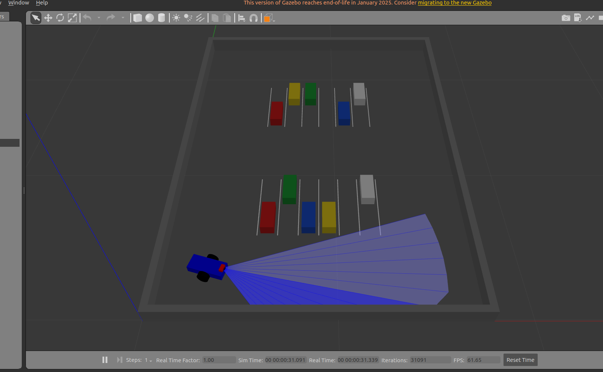
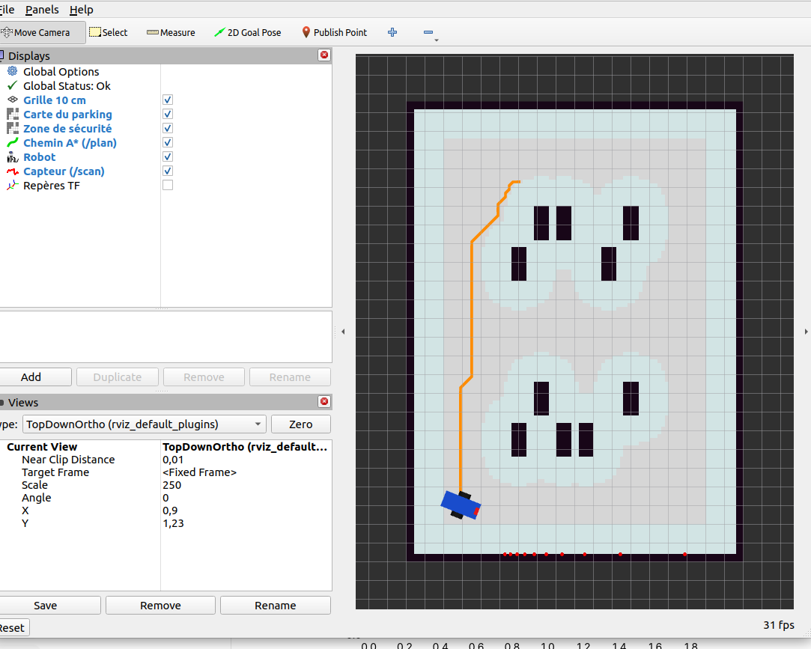
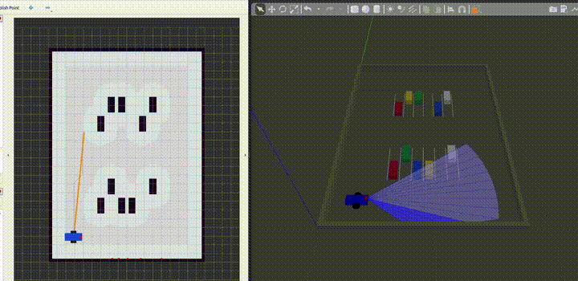

# 🚗 Robot Parking — robot autonome de guidage dans un parking

Projet de 3ᵉ année ISEOC (groupe de 4) : un petit robot mobile retrouve une voiture
dans un parking (maquette à l'échelle) grâce à la vision, puis s'y rend de façon autonome.

**Stack :** ROS 2 Humble · Gazebo Classic 11 · RViz2 · Python · (Jetson Nano + Arduino pour le robot réel)

<p align="center">
  
  
</p>
<p align="center">
  
</p>

## Avancement

| # | Étape | État |
|---|-------|------|
| 1 | Package ROS 2 `robot_parking` + Git | ✅ |
| 2 | Carte de la maquette (`.pgm` / `.yaml`) affichée dans RViz | ✅ |
| 3 | Robot simulé dans le parking Gazebo, pilotage clavier | ✅ |
| 4 | Planification A* publiée sur `/plan` | ✅ |
| 5 | Suivi de chemin jusqu'à une place | ✅ |
| 6 | Arrêt de sécurité (capteur de distance) | ✅ |
| 7 | Mission complète (place ou plaque, lecture simulée) | ✅ |
| ★ | Piéton, re-planification, DWA, PPO + comparaison | ✅ |

Le détail de chaque étape (ce qui a été fait, pourquoi, captures) est dans
[docs/journal.md](docs/journal.md).

## Lancer le projet

```bash
mkdir -p ~/parking_ws/src && cd ~/parking_ws/src
git clone https://github.com/esmat1103/robot_parking.git
cd ~/parking_ws && colcon build --symlink-install && source install/setup.bash

ros2 launch robot_parking carte.launch.py        # étape 2 : la carte dans RViz
ros2 launch robot_parking simulation.launch.py   # étape 3 : Gazebo + RViz
```

## Organisation du dépôt

```
robot_parking/
├── robot_parking/   code Python (carte, générateurs, nœuds)
├── launch/          fichiers de démarrage
├── maps/            carte ROS de la maquette
├── worlds/          monde Gazebo
├── urdf/            description du robot
├── rviz/            configurations RViz
└── docs/            journal de bord et images
```

> ⚠️ **Gazebo (plaques des voitures)** : ajouter une fois dans `~/.bashrc` :
> `export GAZEBO_MODEL_PATH=$HOME/parking_ws/src/robot_parking/models:/usr/share/gazebo-11/models`
> (sinon les plaques s'affichent blanches, à cause des raccourcis créés par `--symlink-install`)
