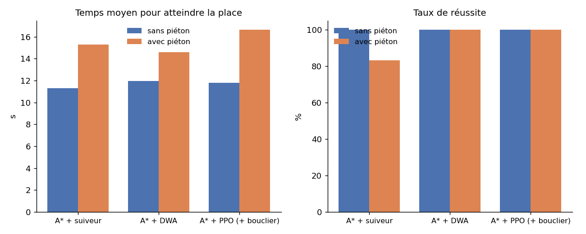

# Comparaison des conducteurs (simulation Gazebo)

6 destinations (A4, B2, B6, C1, C5, D6), sans puis avec un piéton qui traverse l'allée devant le robot. Réussite = arrivé en moins de 60 s sans collision. Temps et distance : moyennes des essais réussis.

| Conducteur | Piéton | Essais | Réussite | Temps moyen | Distance moyenne | Collisions voiture/mur | Collisions piéton | Plus près du piéton |
|---|---|---|---|---|---|---|---|---|
| A* + suiveur | non | 6 | 100 % | 11.3 s | 1.35 m | 0 | 0 | — |
| A* + suiveur | oui | 6 | 83 % | 15.3 s | 1.49 m | 0 | 1 | 4 cm |
| A* + DWA | non | 6 | 100 % | 11.9 s | 1.46 m | 0 | 0 | — |
| A* + DWA | oui | 6 | 100 % | 14.6 s | 1.53 m | 0 | 0 | 14 cm |
| A* + PPO (+ bouclier) | non | 6 | 100 % | 11.8 s | 1.44 m | 0 | 0 | — |
| A* + PPO (+ bouclier) | oui | 6 | 100 % | 16.6 s | 1.43 m | 0 | 0 | 21 cm |

