# Journal de bord — Robot Parking (partie navigation)

Une entrée par étape : **objectif → ce qui a été fait → résultat → ce que j'ai appris.**
Ce journal sert au groupe, au rapport, et au portfolio / LinkedIn.

---

## Étape 1 — Package ROS 2 et Git · ✅

**Objectif :** une base de projet propre et partageable pour les 4 membres.

**Fait :**
- workspace séparé `~/parking_ws` (le TP SLAM reste dans `~/ros2_ws`)
- package Python `robot_parking` (`ament_python`) avec dossiers `launch/ params/ maps/ worlds/`
- `package.xml` (identité, licence MIT, dépendances) et `setup.py` (installation des fichiers)
- dépôt Git + GitHub

**Résultat :** `colcon build` → `1 package finished` ; `ros2 pkg list` voit `robot_parking`.

**Appris :** workspace / package / `colcon build` / `source` ; rôle de `package.xml` (étiquette)
vs `setup.py` (notice d'installation) ; Git (`add`, `commit`, `push`), token GitHub.

---

## Étape 2 — Carte de la maquette dans RViz · ✅

**Objectif :** donner au robot le plan du parking (indispensable pour planifier un chemin).

**Fait :**
- `carte.py` : maquette 1,80 m × 2,46 m, grille de cases de 2 cm, 24 places (A1→D6), 10 voitures garées
- `generer_carte.py` : grille → carte ROS `parking.pgm` (noir = obstacle) + `parking.yaml` (1 px = 2 cm)
- `carte.launch.py` : `map_server` publie `/map`, `lifecycle_manager` l'active, RViz l'affiche

**Choix :** carte **dessinée** à partir des mesures (maquette connue et fixe) plutôt que par SLAM.
Le SLAM produit le même format de fichier → remplaçable plus tard sans changer le reste.

**Résultat :**

| Carte annotée | Carte dans RViz |
|---|---|
| 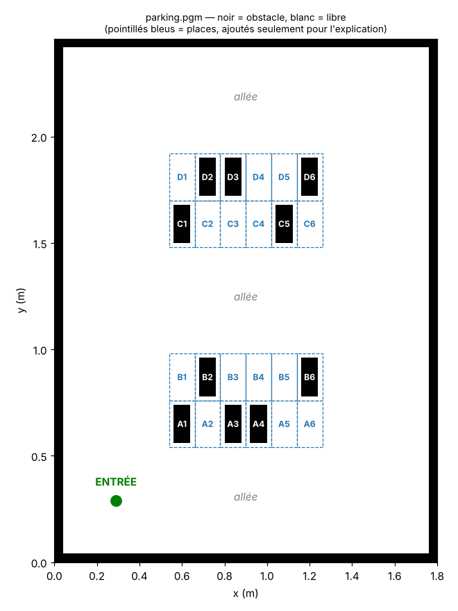 | 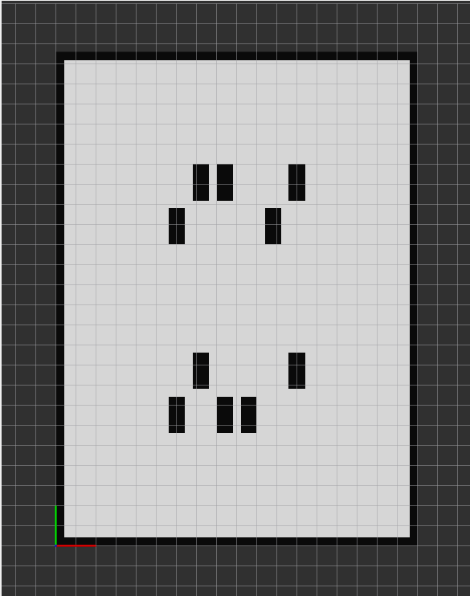 |

**Appris :** format de carte ROS (PGM + YAML, résolution, origine), repère ROS (x droite, y haut),
nœuds lifecycle de Nav2, QoS *Transient Local* du topic `/map`.

---

## Étape 3 — Robot simulé dans Gazebo · ✅

**Objectif :** un « faux parking réel » pour tester sans risque.

**Fait :**
- `generer_monde.py` : le monde Gazebo construit à partir du **même** `carte.py` (cohérence carte ↔ monde)
- `robot.urdf` : châssis 20 × 14 cm, 2 roues motrices Ø 65 mm, capteur de distance avant (70°, 1,2 m)
- `simulation.launch.py` : Gazebo + robot + carte + RViz en une commande

- test : pilotage au clavier (`teleop_twist_keyboard`) → le robot bouge dans Gazebo **et** dans RViz

**Résultat :** le robot apparaît au même endroit dans les deux fenêtres ; les points du capteur
tombent sur les murs de la carte → **le monde Gazebo et la carte correspondent**.

| Gazebo (parking 3D + rayons du capteur) | RViz (carte + robot + points du capteur) |
|---|---|
| 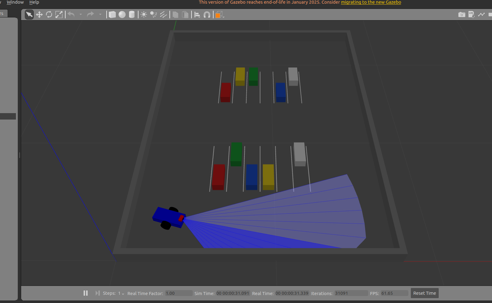 | 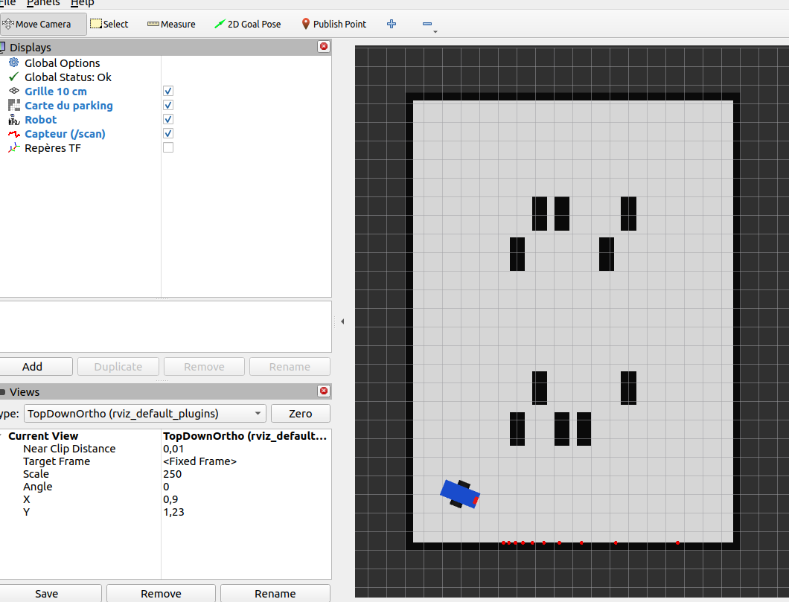 |

**Chaîne validée :** clavier → `/cmd_vel` → roues (Gazebo) → `/odom` + `/scan` → RViz.
Les étapes suivantes remplacent le clavier par du code (A*, suivi de chemin, sécurité).

**Appris :** URDF (links, joints, plugins Gazebo), `robot_state_publisher`, arbre TF
`map → odom → base_footprint → base_link`, `use_sim_time`, plugin `diff_drive`, capteur `ray` → `/scan`.

---

## Étape 4 — Planification A* dans RViz · ✅

**Objectif :** calculer automatiquement le plus court chemin sûr vers une destination (« décider où aller »).

**Fait :**
- `astar.py` (sans ROS, testable seul) :
  - `gonfler()` : agrandit les obstacles de 15 cm (demi-diagonale du robot 12 cm + marge 3 cm)
    → A* peut traiter le robot comme un **point**
  - `astar()` : grille 8-voisins, heuristique octile, interdiction de couper les coins
  - `case_libre_proche()` : si on clique sur un obstacle, on vise la case libre la plus proche
- `planificateur.py` (nœud ROS 2) : écoute `/map`, `/odom`, `/goal_pose` → publie `/plan` et `/carte_securite`
- lancé automatiquement par `simulation.launch.py`

**Résultat :** clic « 2D Goal Pose » dans RViz → chemin orange en quelques millisecondes.

| A* dans RViz (zone de sécurité en bleu clair) | Test hors ROS (3 destinations) |
|---|---|
| 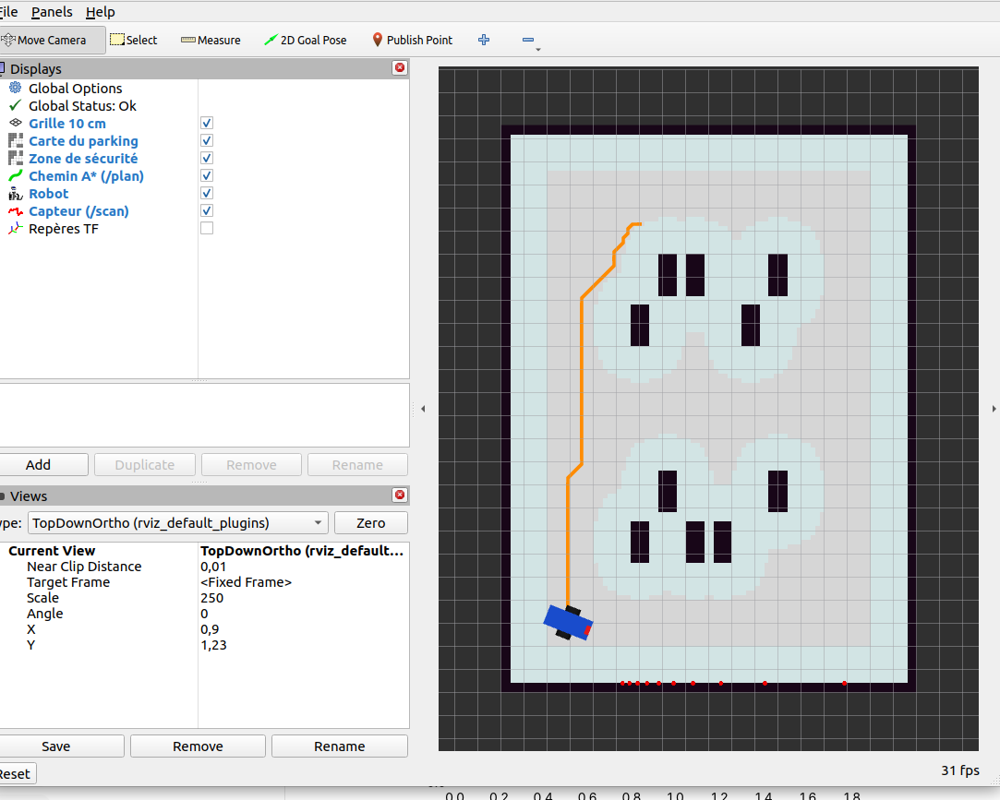 | 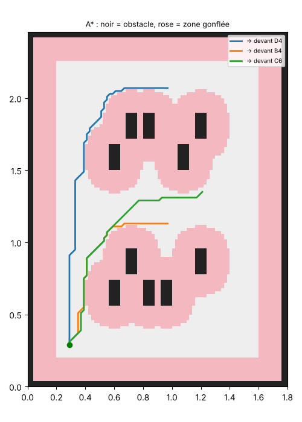 |

**Limite observée :** le chemin longe le bord de la zone de sécurité et fait de petits « escaliers »
(grille 8 directions) → sera lissé à l'étape 5 avant le suivi.

**Appris :** A* (f = g + h, heuristique admissible), gonflement d'obstacles / espace des configurations,
OccupancyGrid (ligne 0 = bas, valeurs 0/100/-1), nav_msgs/Path, QoS Transient Local, paramètres ROS.

---

## Étape 5 — Suivi autonome du chemin · ✅

**Objectif :** remplacer le clavier par un programme (« conduire »).

**Fait :**
- lissage (`simplifier()` dans `astar.py`) : depuis chaque point, saut au point le plus lointain
  atteignable en ligne droite sans toucher la zone de sécurité → les « escaliers » disparaissent
- `suiveur.py` : 20 fois par seconde, vise le prochain point ; pivote sur place si l'écart d'angle
  dépasse 20°, sinon avance (ralentit près du point) ; point suivant à moins de 4 cm ; arrêt au dernier
- `/plan_brut` (gris) et `/plan` lissé (orange) affichés dans RViz

**Résultat :** chemin A* de 2,56 m (112 cases, 26 ms) → lissé en **9 points / 2,43 m**,
parcouru en autonomie en **≈ 20 s** (vitesse max 0,15 m/s).

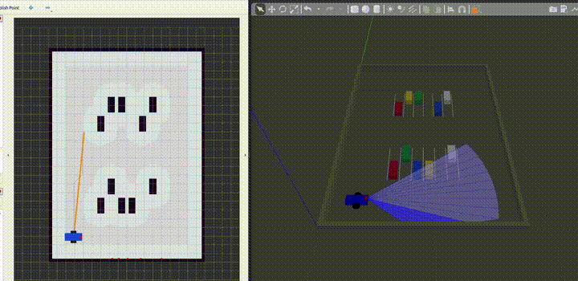

**Appris :** commande d'un robot différentiel (v, ω), quaternion → angle de cap, normalisation d'angle,
boucle de commande à fréquence fixe (timer), compromis vitesse / précision.

---

## Étape 6 — Arrêt de sécurité · ✅

**Objectif :** ne jamais heurter un obstacle **absent de la carte** (personne, carton, voiture mal garée).

**Fait :**
- `securite.py` : « garde du corps » entre le suiveur et les moteurs
  (`suiveur → /cmd_vel_brut → securite → /cmd_vel → moteurs`), grâce à un **remapping** dans le launch
  (le suiveur n'a pas été modifié)
- règles : obstacle < 12 cm → marche avant bloquée ; 12–30 cm → ralentissement ;
  capteur muet > 0,5 s → arrêt ; rotation et recul toujours permis

**Test :** cube ajouté dans Gazebo au milieu de l'allée (inconnu de la carte).

| Temps | Événement |
|---|---|
| +5 s | cube détecté à 30 cm → RALENTI |
| +13 s | cube à 12 cm → **ARRÊT, sans contact** |
| +67 s | cube retiré → OK, le robot repart |
| +73 s | arrivé à destination |

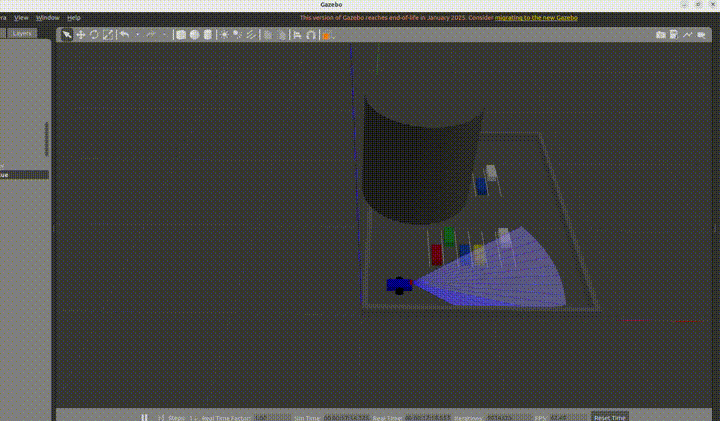

**Limite :** le robot attend que la voie se libère ; il ne contourne pas encore l'obstacle
(→ bonus : re-planification).

**Appris :** séparation des responsabilités entre nœuds, remapping de topics, QoS capteur (Best Effort),
principe de « fail-safe » (arrêt si le capteur se tait).

---

## Étape 7 — Mission complète (lecture de plaque simulée) · ✅

**Objectif :** l'objectif réel du projet — retrouver une voiture et s'arrêter devant elle.

**Fait :**
- `mission.py` : « chef d'orchestre » qui réutilise toute la chaîne existante
  (`/mission → mission → /goal_pose → planificateur → suiveur → sécurité → moteurs`, retour par `/arrivee`)
- deux modes : **nom de place** (`C5`) ou **plaque** (`199 TUN 8125`)
- en mode plaque : visite des voitures **la plus proche d'abord**, arrêt au **point d'approche**
  (dans l'allée, devant l'entrée de la place), « lecture » 1,5 s, comparaison, place suivante
- lecture de plaque **simulée** (`lire_plaque()` + tableau `PLAQUES`) : c'est **le seul point
  à remplacer** par la vision (caméra + YOLO)

**Résultat — recherche de `199 TUN 8125` :**

| # | Place | Plaque lue | Trajet |
|---|---|---|---|
| 1 | A1 | 112 TUN 3452 ✗ | 0,33 m |
| 2 | A3 | 205 TUN 1187 ✗ | 0,28 m |
| 3 | A4 | 098 TUN 7741 ✗ | 0,16 m |
| 4 | B2 | 187 TUN 2290 ✗ | 1,38 m |
| 5 | C1 | 150 TUN 9012 ✗ | 0,18 m |
| 6 | C5 | 176 TUN 5530 ✗ | 0,46 m |
| 7 | B6 | 231 TUN 0456 ✗ | 0,23 m |
| 8 | **D6** | **199 TUN 8125 ✓** | 1,07 m |

**8 voitures vérifiées, ≈ 4,1 m, ≈ 50 s, sans collision.** Chaque trajet A* calculé en < 10 ms.

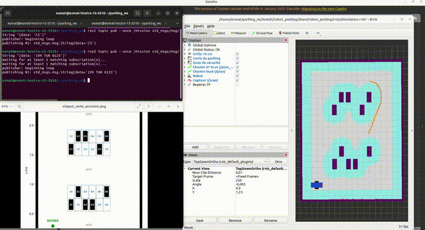

**Limite :** « la plus proche d'abord » est une heuristique, pas la tournée optimale.

**Appris :** machine à états (ATTENTE → EN_ROUTE → LECTURE → FINI), coordination de nœuds par topics,
conception « par interfaces » (la vision se branche sans toucher à la navigation).

---

## Bilan de la partie navigation (indispensable) · ✅

Chaîne complète validée en simulation :
**carte → A* + zone de sécurité → lissage → suivi autonome → arrêt de sécurité → mission place / plaque.**

Prochaines pistes : décor réaliste (miniatures + plaques) et caméra pour la vision ; bonus :
re-planification autour d'un obstacle, DWA / piétons, PPO, SLAM, Nav2 ; passage au robot réel.

---

## Vision — partie A : caméra + orientation d'arrivée · ✅

- caméra ajoutée au robot (640 × 480, 60°, 15 images/s, inclinée de 14° vers le bas) → `/camera/image_raw`
- le robot finit **face à la place** : la mission envoie une orientation d'arrivée (+90° rangées A/C,
  −90° rangées B/D), le planificateur la recopie sur le dernier point, le suiveur pivote jusqu'à ±3°
- avec « 2D Goal Pose », la direction de la flèche est maintenant respectée

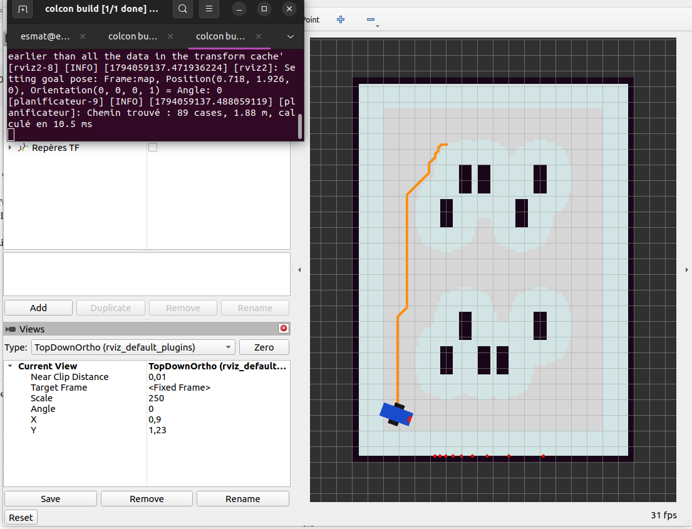

---

## Vision — partie B : voitures réalistes + plaques tunisiennes · ✅

- les boîtes colorées sont remplacées par **7 modèles 3D** (citadines 5 couleurs, SUV, berline,
  modèles OSRF, licence CC BY 3.0) réduits à 19 × 8 cm
- chaque voiture porte **sa plaque tunisienne** (chiffres + « تونس ») à l'avant et à l'arrière ;
  ce sont **les mêmes plaques que le tableau `PLAQUES`** → simulation et future vision cohérentes
- `worlds/voitures.csv` : la « vérité » (place, couleur, type, plaque) pour tester la vision
- problème rencontré : plaques grises (sans chiffres). Cause : avec `--symlink-install`, `install/`
  ne contient que des raccourcis et le moteur graphique OGRE ne charge pas les images.
  Solution : Gazebo lit les modèles directement dans `src/models`.

**Démo :** mission « C5 » → le robot rejoint la citadine grise, se tourne face à elle,
et la caméra voit sa plaque **176 تونس 5530**.

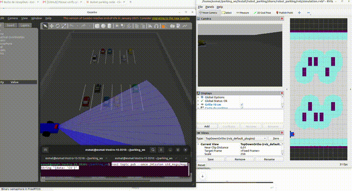

**Vue de la caméra du robot devant C5 :** plaque « 5530 تونس 176 » nette et dans le bon sens
(pas de miroir) → images exploitables pour entraîner YOLO / la lecture des chiffres.

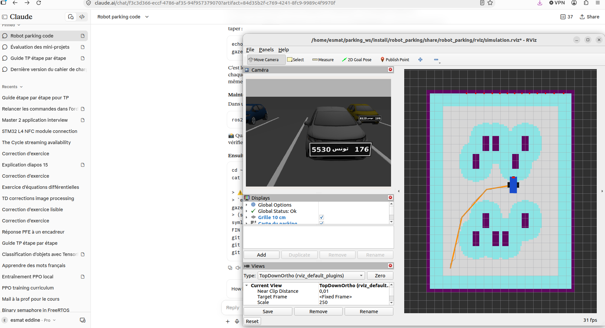

---

## Vision — V1 : collecte d'images · ✅

- `collecteur.py` : écoute `/mission_etat` ; à chaque « Arrivé devant X », enregistre l'image
  de la caméra dans `~/parking_ws/dataset/sim/X.png` (0,5 s après, image stable)
- mission avec une plaque inexistante → le robot visite les 10 voitures → **10 images en ≈ 75 s**
- les images restent hors du dépôt (`~/parking_ws/dataset/`)

**Démo :** tournée du robot devant les voitures, le panneau Caméra de RViz montre chaque plaque
au moment où le robot s'arrête face à la place.

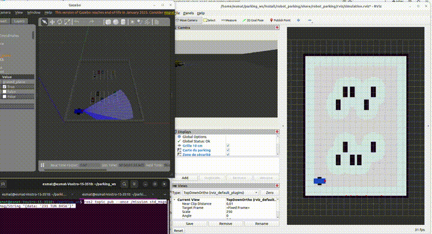

---

## Vision — V2 : lecture de plaque (OpenCV + Tesseract) · ✅

- `lecture_plaque.py` (sans ROS) : 1) trouver la plaque (zone sombre ≈ 4:1 contenant des chiffres
  blancs) 2) la redresser en 600 × 150 3) lire le numéro (zone gauche) et la série (zone droite)
  avec Tesseract limité aux chiffres
- `tester_lecture.py` : compare la lecture des 10 images avec `voitures.csv`

| Essai | Score | Cause des erreurs |
|---|---|---|
| v1, arrêt à 17 cm (tolérance 4 cm) | 7/10 | rangée D : plaque **coupée par le bord de l'image** (robot décalé latéralement) |
| v2, découpage « intelligent » | 5/10 | n'a pas traité la vraie cause, a ajouté des erreurs → abandonnée |
| v1, arrêt à **25 cm**, précision finale **1,5 cm** | **10/10** | — (≈ 0,24 s par image) |

**Leçon :** la vraie cause était la **prise de vue** (position d'arrêt), pas l'algorithme de lecture.
**Limite :** testé sur 10 images de simulation (police nette, éclairage parfait) ; à revalider sur la maquette.

---

## Vision — V3 : lecture caméra branchée dans la mission · ✅

- `mission.py` lit la plaque sur **l'image de la caméra** (`lire_plaque_image`) au lieu du tableau ;
  le tableau `PLAQUES` sert seulement de **contrôle** (✅ / ❌) ; jusqu'à 3 essais si illisible ;
  paramètre `lecture:=simulee` pour revenir à l'ancienne lecture
- 1ʳᵉ mission : 8/9 justes (A4 lu « 77414 » : la zone du numéro mordait sur تونس)
  → zone réduite (42 → 38 %) + **contrôle du format tunisien** (numéro ≤ 4 chiffres, série ≤ 3)
- 2ᵉ mission « 199 TUN 8125 » : **9/9 plaques lues justes par la caméra**, véhicule trouvé en D6, tournée ≈ 79 s

**Le robot ne triche plus : il décide « trouvé / pas trouvé » à partir de ce que lit sa caméra.**

---

## Vision — V4 : détection de voiture YOLOv8 (pré-entraîné, sans entraînement) · ✅

- `vision_yolo.py` : YOLOv8 COCO (classes car / truck / bus = « véhicule »), on garde le véhicule
  **juste devant** (rectangle ≥ 20 % de la largeur de l'image et centré)
- comparaison sur les 10 images (`tester_yolo`) :

| Modèle | Seuil | Détectées | Confiance | Temps |
|---|---|---|---|---|
| yolov8n | 0,30 | 7/10 | 0,34 – 0,80 | ≈ 55 ms |
| yolov8n | 0,15 | 8/10 | 0,15 – 0,29 | ≈ 70 ms |
| **yolov8s** | **0,30** | **9/10** | **0,36 – 0,91** | ≈ 125 ms |

  → **yolov8s retenu**. Limites : COCO ne distingue pas citadine / SUV / berline (le SUV était vu comme
  « bus ») ; B6 (citadine verte) jamais détectée
- dans la mission : **YOLO voit un véhicule OU une plaque lisible devant → place occupée**, sinon **vide**
- piège découvert : à travers une place vide (C3), la caméra voit les voitures de la rangée D **au loin**,
  avec leurs plaques → fausse lecture. Correction : **la taille, c'est la distance**
  (plaque ≥ 15 % de l'image, véhicule ≥ 20 %)
- tests : C3 vide ✅, B6 occupée grâce à la plaque ✅, D2 détectée par YOLOv8s ✅
- installation : PyTorch CPU + `numpy<2` (sinon cv_bridge casse) ; après un `pip install`, si `colcon build`
  échoue sur setuptools → `python3 -m pip uninstall -y setuptools`

---

## Dynamique — D1 : piéton dans Gazebo · ✅

- `pieton.py` : un piéton (cylindre rouge Ø 8 cm, échelle 1:24) fait des allers-retours dans l'allée
  du milieu à 8 cm/s, 4 s après le départ du robot ; il est déplacé par `/set_entity_state`
  et publie sa position et sa vitesse sur `/pieton` (pour DWA)
- il a une **forme de collision** : le capteur `/scan` le voit (sinon il serait invisible pour le robot)
- test mission C5 : la sécurité voit le piéton (29 → 22 cm), le robot **ralentit**, le piéton passe,
  le robot repart ; mission réussie
- limite : face à un obstacle, le robot **attend** ou ralentit, il ne le **contourne** pas encore → D2

---

## Dynamique — D2 : re-planification (le robot contourne) · ✅ test A

- `planificateur.py` écoute maintenant `/scan` : chaque point vu qui n'est pas un obstacle connu
  devient un **obstacle imprévu** (oublié s'il n'est plus vu depuis 3 s)
- 2 fois par seconde : si le chemin **restant** traverse un obstacle imprévu (gonflé de 16 cm),
  A* recalcule un chemin qui le contourne ; sinon (aucun contournement), la sécurité fait attendre
- obstacles imprévus visibles dans RViz (`/obstacles_vus`) ; `replanification:=False` = ancien comportement
- **test A** : cube posé dans l'allée de gauche (inconnu de la carte), mission C1 → le robot voit le cube,
  **re-planifie** et rejoint C1 par une autre allée, sans s'arrêter devant

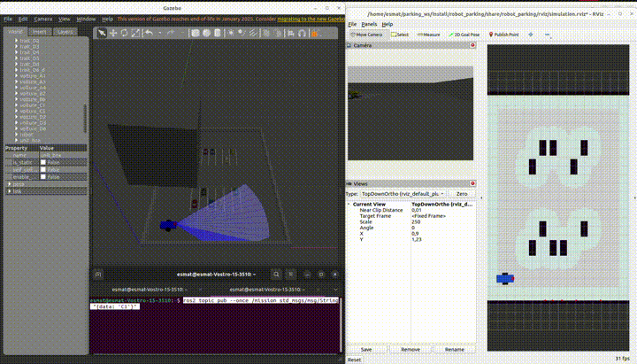

**Test B (piéton qui traverse, mission C5) :** avec D2 seul, le robot re-planifie un **détour de 2,54 m
(≈ 33 s au lieu de ≈ 13 s)** au lieu d'attendre 2 à 3 s → il traite le piéton comme un obstacle immobile.

---

## Dynamique — D2b : priorité piéton · ✅

- **planificateur** : un point vu à moins de 12 cm du piéton (`/pieton`) est « mobile ».
  Obstacle immobile → **contourner** ; piéton → **attendre** ; piéton bloquant **plus de 8 s** → contourner ;
  piéton parti pendant le détour → **reprendre le chemin le plus court**
- **sécurité** : arrêt si le piéton est **dans le couloir du robot** (≤ 14 cm de son axe) à moins de 35 cm
- en simulation, la position du piéton vient du nœud `pieton` ; sur le vrai robot : la vision (YOLO, « person »)

**Bugs trouvés et corrigés en testant :**
1. cône de ±60° trop large + piéton en allers-retours sans fin → robot bloqué → test « dans le couloir »
   + piéton qui traverse **une fois**
2. le piéton restait 3 s en mémoire après son départ → détour inutile alors que le passage était libre
   → mémoire du piéton réduite à 0,5 s + vérifier qu'il est **toujours là** avant de contourner

**Résultats (mission C5) :**

| Scénario | Comportement | Temps |
|---|---|---|
| sans piéton | — | ≈ 13 s |
| piéton qui traverse, D2 (tout contourner) | détour 2,54 m | ≈ 33 s |
| piéton qui traverse, **D2b** | attend, puis tout droit | **≈ 15 s** |
| piéton arrêté 5 s, **D2b** | attend, puis tout droit | ≈ 19 s |
| piéton arrêté 15 s, **D2b** | attend 8 s, contourne, reprend le chemin court quand il part | ≈ 39 s |

| Piéton arrêté 5 s : le robot attend | Piéton arrêté 15 s : le robot contourne |
|---|---|
| 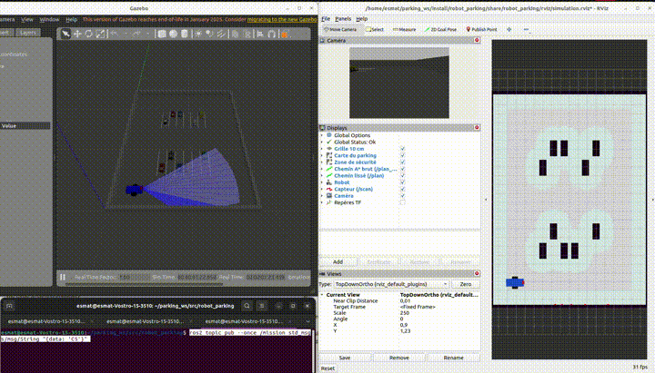 | 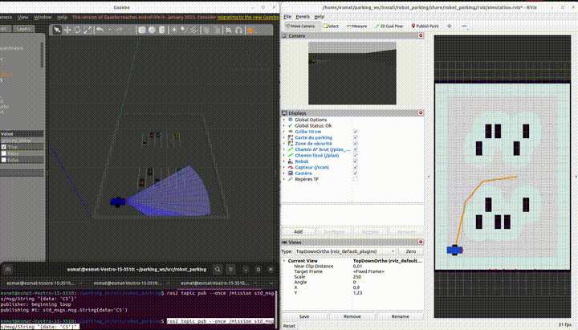 |

**Lecture de plaque plus robuste :**
- **vote** : jusqu'à 3 images lues, on garde la réponse quand 2 lectures concordent
  (écarte une erreur isolée, ex. un « 5 » lu « 9 »)
- limite : le vote ne corrige pas une erreur **systématique** (même vue → même erreur) ; elle dépend
  de la position d'arrêt exacte (observée une fois après un détour)
- chaque lecture fausse est **enregistrée** dans `~/parking_ws/dataset/erreurs/` (image caméra + contrôle)
  pour pouvoir la diagnostiquer

---

## Dynamique — D3 : conducteur DWA (anticipation du piéton) · ✅

- `suiveur_dwa.py` (d'après l'ancien `dwa.py`), même interface que le suiveur ; choix au lancement :
  `ros2 launch robot_parking simulation.launch.py controleur:=dwa`
- 10 fois par seconde : fenêtre des vitesses atteignables → 66 trajectoires imaginées sur 1,5 s →
  rejet de celles qui touchent un obstacle ou la **position future** du piéton (marge qui grossit
  avec le temps) → note : cible + dégagement + vitesse
- ajouts : **mode précis** « tourner puis avancer » à moins de 10 cm du but (lecture de plaque),
  **déblocage** (pivot) si aucun progrès en 3 s ; avec DWA, l'arrêt « piéton » de la sécurité passe à 22 cm

**Mission C5 (un essai par scénario) :**

| Conducteur | Sans piéton | Piéton qui traverse | Comportement |
|---|---|---|---|
| Suiveur + D2 (tout contourner) | ≈ 13 s | ≈ 33 s | détour de 2,54 m |
| Suiveur + D2b (priorité piéton) | ≈ 13 s | ≈ 15 s | s'arrête, puis repart |
| **DWA** | **13,1 s** | **14,3 s** | **ralentit sans s'arrêter, passe derrière** |

→ à confirmer avec plusieurs essais (évaluation automatique, D5).

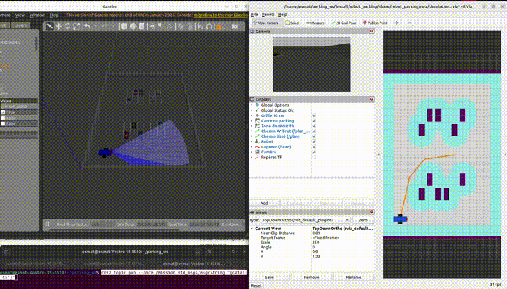

---

## Dynamique — D4 : conducteur PPO + bouclier de sécurité · ✅

- `suiveur_ppo.py` : le réseau PPO **entraîné dans l'ancien projet** (simulation 2D, 78/90) est
  réutilisé **sans réentraînement** : ses 19 observations sont **locales** (point de passage, vitesses,
  9 rayons, piéton vus par le robot) → indépendantes de la carte. 7 actions, 20 décisions/s.
- **bouclier** : imagine 1,5 s d'avenir ; si l'action est dangereuse → action sûre préférée de PPO
  ou action d'urgence (reculer)
- problème : modèle sauvegardé avec numpy 2, projet en numpy 1 (cv_bridge) → on charge seulement
  les **poids** (`policy.pth`) dans un réseau reconstruit à l'identique (2 × 64 neurones)
- choix au lancement : `controleur:=ppo`

**Mission C5 (un essai par cas) :**

| Conducteur | Sans piéton | Avec piéton | Temps perdu | Interventions |
|---|---|---|---|---|
| Suiveur + D2b | ≈ 13 s | ≈ 15 s | ≈ 2 s | arrêt piéton |
| DWA | 13,1 s | 14,3 s | ≈ 1 s | 1 ralentissement |
| PPO + bouclier | 11,6 s | 19,1 s | ≈ 7,5 s | aucune (bouclier 0/282) |

- **transfert réussi** : entraîné en 2D sans inertie, PPO conduit dans Gazebo sur une maquette inconnue
- PPO plus **prudent** face au piéton ; DWA plus **efficace** (passe derrière)
- limites : 1 essai par cas ; PPO roule à 0,20 m/s (entraînement) contre 0,15 pour les autres
  → évaluation automatique avec les mêmes vitesses (D5)

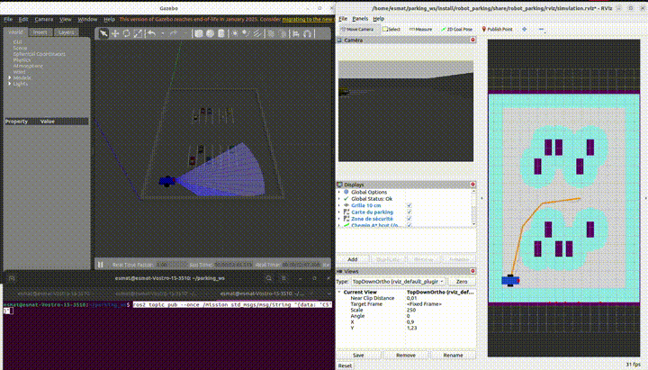
